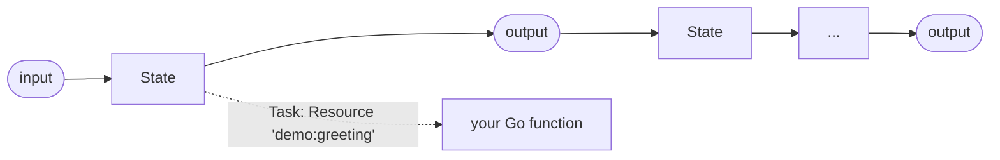

# Learning `state-machine-amz-go`

A small, runnable tour of
[`github.com/hussainpithawala/state-machine-amz-go`](https://github.com/hussainpithawala/state-machine-amz-go),
pinned to **v1.2.22**.

The goal is not to document every API. The goal is to get you from "I have
never used this library" to "I can read an ASL workflow, wire it to Go
functions, handle errors, and persist executions" by running seven focused
examples.

The first six steps need nothing but Go. Step 7 uses PostgreSQL via Docker
Compose.

## Contents

- [Quick start](#quick-start)
- [The 60-second mental model](#the-60-second-mental-model)
- [Two APIs, one workflow format](#two-apis-one-workflow-format)
- [Repository map](#repository-map)
- [Step 1 — One Task, one handler](#step-1--one-task-one-handler)
- [Step 2 — Branching with Choice](#step-2--branching-with-choice)
- [Step 3 — Shaping data between states](#step-3--shaping-data-between-states)
- [Step 4 — Retry, Catch, and failure](#step-4--retry-catch-and-failure)
- [Step 5 — Concurrent branches with Parallel](#step-5--concurrent-branches-with-parallel)
- [Step 6 — Waiting without polling](#step-6--waiting-without-polling)
- [Step 7 — Persistence with PostgreSQL](#step-7--persistence-with-postgresql)
- [Why `internal/lab` exists](#why-internallab-exists)
- [Known bugs in v1.2.22](#known-bugs-in-v1222)
  - [Outright bugs](#outright-bugs)
  - [ASL incompatibilities and design constraints](#asl-incompatibilities-and-design-constraints)
- [Troubleshooting](#troubleshooting)
- [Where to go next](#where-to-go-next)
- [Credits](#credits)

---

## Quick start

Run everything from the repository root:

```bash
go run ./step01_hello
go run ./step02_choice
go run ./step03_dataflow
go run ./step04_errors
go run ./step05_parallel
go run ./step06_wait
```

Or run steps 1–6 in order:

```bash
make demo
```

Step 7 needs the database:

```bash
make db-up          # or: make db-up DOCKER="sudo docker"
go run ./step07_history
make db-down
```

Requirements:

- Go **1.24+** (the library's own `go.mod` targets 1.24.0)
- Docker only for step 7

No prior Amazon States Language (ASL) knowledge is assumed.

---

## The 60-second mental model

A workflow is a JSON or YAML document in **Amazon States Language**. It has a
start state and a map of named states:

```yaml
StartAt: MakeGreeting
States:
  MakeGreeting:
    Type: Task
    Resource: "demo:greeting"
    Next: Done

  Done:
    Type: Succeed
```

Each state receives some input, does something, and produces output. `Next`
names the following state; `End: true` or a terminal state type finishes the
execution.

The library:

1. parses and validates the ASL document;
2. walks the state graph;
3. for `Task` states, looks up a Go function by the state's `Resource` string;
4. optionally persists definitions, executions, and state history in Postgres.

The single most surprising thing for newcomers: **this library does not call
AWS**. `Resource` is just a lookup key. You register a Go function under that
name, and the library calls it.



---

## Two APIs, one workflow format

The library has two execution engines:

| | In-memory | Persistent |
|---|---|---|
| Import | `pkg/statemachine` | `pkg/statemachine/persistent` |
| Constructor | `statemachine.New(def, isJSON)` | `persistent.New(def, isJSON, id, manager)` |
| Database | no | PostgreSQL |
| Execute | `sm.Execute(ctx, input)` | `sm.SaveDefinition(ctx)` then `sm.Execute(ctx, input)` |
| History | returned in memory | stored in and read from the database |
| Used in | step 1 | step 7 |

Steps 2–6 use a tiny shared runner in `internal/lab` rather than the
in-memory `Execute` method. The reason is explained in
[Why `internal/lab` exists](#why-internallab-exists). It is not a hidden
framework; it is about 100 lines and it works around a real data-flow bug in
v1.2.22 instead of silently teaching the wrong behaviour.

---

## Repository map

```text
.
├── docker-compose.yml          Postgres for step 7
├── Makefile                    demo shortcuts
├── internal/lab/lab.go         tiny runner + trace printer
├── workflows/                  the ASL definitions
│   ├── 01_hello.yaml
│   ├── 02_choice.yaml
│   ├── 03_dataflow.yaml
│   ├── 04_retry_catch.yaml
│   ├── 04_uncaught.yaml
│   ├── 05_parallel.yaml
│   ├── 06_wait.yaml
│   └── 07_persistent.yaml
├── step01_hello/main.go
├── step02_choice/main.go
├── step03_dataflow/main.go
├── step04_errors/main.go
├── step05_parallel/main.go
├── step06_wait/main.go
└── step07_history/main.go
```

Each step is a `main` package. Read the Go file and the matching YAML side by
side; the comments point at the parts worth noticing.

---

## Step 1 — One Task, one handler

**Files:** `workflows/01_hello.yaml`, `step01_hello/main.go`

```bash
go run ./step01_hello
```

The workflow is one `Task` that calls `demo:greeting` and ends.

The Go side has three jobs:

```go
// 1. Parse the definition. false means "this is YAML".
sm, err := statemachine.New(definition, false)

// 2. Register a Go function under the Task's Resource name.
exec := executor.NewBaseExecutor()
exec.RegisterGoFunction("demo:greeting", myHandler)

// 3. Make the executor reachable from the context the library uses.
ctx = context.WithValue(ctx, types.ExecutionContextKey,
    executor.NewExecutionContextAdapter(exec))

// 4. Run it.
result, err := sm.Execute(ctx, input, statemachine.WithExecutionName("step01-hello"))
```

`Parameters` builds the handler's input:

```yaml
Parameters:
  name: "$.name"
  language: "en"
```

A value beginning with `$` is a JSONPath lookup into the current state input.
The handler therefore receives `{"name": "Ada", "language": "en"}`.

**Takeaway:** a Task is just a named Go function plus input/output shaping. The
context value in step 3 is mandatory; without it the Task silently passes its
input through unchanged.

> AWS ASL writes `name.$: $.name`. This engine expects the value itself to be
> the path, as shown above. See [Known bugs in v1.2.22](#known-bugs-in-v1222).

---

## Step 2 — Branching with Choice

**Files:** `workflows/02_choice.yaml`, `step02_choice/main.go`

```bash
go run ./step02_choice
```

`Choice` is the ASL `if/else`. It calls no handler. It evaluates rules against
the current input and returns the name of the next state. Rules are tried top
to bottom; the first match wins. `Default` handles the no-match case.

```yaml
RouteOrder:
  Type: Choice
  Choices:
    - And:
        - Variable: "$.total"
          NumericGreaterThanEquals: 200
        - Variable: "$.tier"
          StringEquals: "gold"
      Next: Premium
    - Variable: "$.total"
      NumericGreaterThanEquals: 200
      Next: Standard
    - Variable: "$.total"
      NumericLessThan: 50
      Next: Small
  Default: Standard
```

The program runs four scenarios, including a compound `And`, a simple numeric
match, a `Pass` branch, and the `Default` branch.

**Takeaway:** `Choice` is pure routing. Keeping business decisions in the
workflow makes the branch structure visible without running any Go code.

> The example uses a flat input document on purpose. Nested `Parameters` paths
> hit a double-expansion bug in v1.2.22; see
> [Known bugs in v1.2.22](#known-bugs-in-v1222).

---

## Step 3 — Shaping data between states

**Files:** `workflows/03_dataflow.yaml`, `step03_dataflow/main.go`

```bash
go run ./step03_dataflow
```

ASL gives each state several data knobs. The example applies all of them in one
`Task`:

| Field | Question it answers |
|---|---|
| `InputPath` | What part of the incoming document does this state see? |
| `Parameters` | What custom input should the Task handler receive? |
| `ResultSelector` | Which fields of the handler's result do I want, possibly renamed? |
| `ResultPath` | Where do I merge that result in the state's input? |
| `OutputPath` | What part of the merged document does the next state see? |

```yaml
BuildSummary:
  Type: Task
  Resource: "demo:summary"
  InputPath: "$.customer"
  ResultSelector:
    name: "$.name"
    loyaltyTier: "$.tier"
    lifetimeOrders: "$.history.orders"
  ResultPath: "$.summary"
  OutputPath: "$.summary"
  Next: AddMetadata
```

Watch the printed trace: `demo:summary` receives only the customer object,
`AddMetadata` receives only the selected summary, and the final output contains
the summary plus the metadata added by the second task.

**Takeaway:** use paths to keep state payloads small and explicit. The trace
printer shows exactly what each state saw and produced.

---

## Step 4 — Retry, Catch, and failure

**Files:** `workflows/04_retry_catch.yaml`, `workflows/04_uncaught.yaml`,
`step04_errors/main.go`

```bash
go run ./step04_errors
```

Three scenarios run:

1. **Transient failure** — `demo:charge` returns `ServiceUnavailable` twice,
   succeeds on the third attempt. A `Retry` rule handles it.
2. **Business failure** — `PaymentDeclined` is caught and routed to a `Refund`
   `Pass` state.
3. **Uncaught failure** — `InventoryUnavailable` has no `Catch`, so the
   execution ends as `FAILED`.

```yaml
ChargeCard:
  Type: Task
  Resource: "demo:charge"
  Retry:
    - ErrorEquals: ["ServiceUnavailable"]
      MaxAttempts: 3
      BackoffRate: 1.0
  Catch:
    - ErrorEquals: ["PaymentDeclined"]
      ResultPath: "$.error"
      Next: Refund
```

`ErrorEquals` is matched against the handler's **error text**:

```go
return nil, errors.New("PaymentDeclined") // matches "PaymentDeclined"
```

`States.ALL` matches any error. A wrapped error such as
`fmt.Errorf("charge failed: %w", err)` does **not** match a bare
`"PaymentDeclined"` rule, because the comparison is on the complete
`err.Error()` string.

**Takeaway:** use short, stable error strings as your error contract. Catch
turns a terminal Task error into a normal transition; without a catch it fails
the execution.

> In v1.2.22, `Retry.IntervalSeconds` is ignored. The first delay is 1 second
> and `BackoffRate` multiplies it. `MaxAttempts` is taken from the first Retry
> rule. Keep demos short by using `BackoffRate: 1.0`.

---

## Step 5 — Concurrent branches with Parallel

**Files:** `workflows/05_parallel.yaml`, `step05_parallel/main.go`

```bash
go run ./step05_parallel
```

A `Parallel` state starts every branch with the same input and waits for all of
them. The results are returned as an array in **branch order**, not completion
order.

The three handlers each sleep 400ms. The printed wall-clock duration is about
400ms, not 1200ms:

```text
  shipping  started at +0s
  stock     started at +0s
  price     started at +0s

status:   SUCCEEDED
duration: 401ms
```

If any branch fails, the whole `Parallel` state fails.

**Takeaway:** `Parallel` is a structured fan-out/fan-in. Each branch is itself
a mini state machine with its own `StartAt` and `States`.

---

## Step 6 — Waiting without polling

**Files:** `workflows/06_wait.yaml`, `step06_wait/main.go`

```bash
go run ./step06_wait
```

`Wait` parks the execution on a timer. It does not spin or poll, and it is
interruptible through the `context.Context`:

```yaml
Pause:
  Type: Wait
  SecondsPath: "$.delaySeconds"
  Next: Finish
```

The example runs twice:

1. a one-second wait that succeeds;
2. a two-second wait under a 300ms context deadline, which fails with
   `context deadline exceeded`.

**Takeaway:** in this implementation `Wait` holds the executing goroutine
while it sleeps. It is not a distributed, durable timer. For long waits that
must survive process restarts, look at the persistent engine's recovery and
message features (outside the scope of this tutorial).

---

## Step 7 — Persistence with PostgreSQL

**Files:** `workflows/07_persistent.yaml`, `step07_history/main.go`

Start the database first:

```bash
make db-up
go run ./step07_history
```

If Docker requires root on your machine:

```bash
make db-up DOCKER="sudo docker"
go run ./step07_history
```

The Compose file starts `postgres:16-alpine` with:

```text
user:     tutorial
password: tutorial
database: tutorial
port:     5432
```

Override the connection with `DATABASE_URL` if needed.

The program shows the persistent API lifecycle:

```go
manager, _ := repository.NewPersistenceManager(&repository.Config{
    Strategy:      "gorm-postgres",
    ConnectionURL: dsn,
})
manager.Initialize(ctx) // creates/migrates tables

sm, _ := persistent.New(definition, false, "tutorial-step07", manager)
sm.SaveDefinition(ctx) // upsert the workflow definition

result, _ := sm.Execute(ctx, input,
    statemachine.WithExecutionName(uniqueName))

history, _ := sm.GetExecutionHistory(ctx, result.ID)
```

It also demonstrates:

- reading the definition back with `persistent.NewFromDefnId`;
- `ListExecutions` with a status filter;
- `CountExecutions`;
- persistence across process restarts: run the program twice and the list
  grows.

**Takeaway:** the persistent engine keeps the same ASL definitions and Go
handlers, but stores definitions, executions, and per-state history in
Postgres. Execution names must be unique per state machine when you supply one
with `WithExecutionName`.

Stop or reset the database:

```bash
make db-down      # stop, keep data
make db-reset     # stop and delete the volume
```

---

## Why `internal/lab` exists

Steps 2–6 use `internal/lab.Run` instead of `statemachine.Execute`. Here is the
v1.2.22 behaviour behind that choice.

The library's in-memory runner reads `execCtx.Input` for **every** state:

```go
// pkg/statemachine/statemachine.go (v1.2.22, simplified)
output, nextState, err := sm.executeStateWithRecovery(ctx, state, execCtx.Input, ...)
...
currentInput = output
```

`currentInput` is updated, but the next iteration still passes `execCtx.Input`.
So in a multi-state in-memory workflow, every state receives the original
workflow input rather than the previous state's output. A one-state workflow
(step 1) is unaffected, which is why step 1 uses the real `Execute` method.

`lab.Run` implements the standard ASL loop directly on the parsed state
objects:

```go
output, next := state.Execute(ctx, currentInput)
currentInput = output
```

This keeps steps 2–6 database-free and free of the upstream bug, without
pretending the bug does not exist. Step 7 uses the persistent engine, which
does thread data forward (it merges each state's output into the execution
input).

If you only need one state, `statemachine.Execute` is fine. If you need a
multi-state in-memory workflow with standard ASL data flow today, either use
the persistent engine or a small loop like `lab.Run`.

---

## Known bugs in v1.2.22

These are implementation defects and spec gaps, not intended ASL behaviour.
They are listed explicitly because a tutorial that quietly worked around them
would teach you the wrong mental model. Verify them upstream if you upgrade.

To be direct: eight of these are outright bugs, not merely surprising
behaviour. They either violate ASL semantics (`Fail` succeeding, data flow not
threading, persistent keys accumulating), silently change behaviour
(`IntervalSeconds` ignored), or fail in a way that hides the real problem
(double-expanded `Parameters`, silent Task→Pass fallback, exact-text error
matching). `Map` is a missing implementation that the public documentation
implies exists; functionally, that is also a defect.

The remaining two are better classified as an ASL incompatibility and a design
constraint: `key.$` syntax is unsupported, and execution names are unique per
state machine. They are not bugs in the same sense, but callers still have to
design around them.

Why make the distinction? Bugs violate the intended semantics and may be fixed
upstream, so workarounds should be treated as temporary. Incompatibilities and
constraints are properties of the current API that you must plan for. In both
cases, do not copy a silent-failure workaround into production code without
adding an explicit error path of your own.

### Outright bugs

1. **In-memory multi-state data flow is broken.** As described above, the
   in-memory runner passes the original workflow input to every state instead
   of the previous state's output.

2. **A missing executor silently turns Tasks into Pass states.** If you forget
   `context.WithValue(ctx, types.ExecutionContextKey, ...)`, a `Task` returns
   its input unchanged. There is no error or warning.

3. **`Parameters` is expanded twice.** `prepareInput` expands it, then
   `DefaultTaskHandler.Execute` expands it again. A same-name top-level lookup
   such as `name: "$.name"` works. A nested lookup such as
   `orderId: "$.order.id"` resolves on the first pass and then fails on the
   second (`field 'order' not found`). Literal values are safe. Prefer
   `InputPath`/`ResultSelector` for anything non-trivial.

4. **`Fail` states do not fail.** `FailState.Execute` returns a nil error, so
   the execution is marked `SUCCEEDED`. Use a Task that returns a Go error, or
   treat the `Fail` state as documentation only.

5. **`Map` is not registered.** The factory handles `Pass`, `Fail`, `Succeed`,
   `Wait`, `Choice`, `Parallel`, `Task`, and `Message`, but not `Map`, despite
   what the README may claim.

6. **`ErrorEquals` compares raw error text.** It matches the complete
   `err.Error()` string exactly, or `States.ALL`. Wrapped errors and typed
   errors do not match a bare name.

7. **`Retry.IntervalSeconds` is ignored.** The base delay is always 1 second,
   multiplied by `BackoffRate`. `MaxAttempts` comes from the first Retry rule.

8. **Persistent data flow never replaces earlier keys.** The persistent runner
   merges each state's output back into the execution input rather than
   replacing it. Scenarios where a state is supposed to drop earlier keys can
   therefore behave differently from AWS Step Functions. Use
   `ResultPath`/`OutputPath` deliberately and inspect history.

### ASL incompatibilities and design constraints

These may be deliberate design choices or missing features, but they still
differ from AWS ASL:

- **AWS `key.$` syntax is not supported.** Write `name: "$.name"`, not
  `name.$: "$.name"`.
- **Execution names must be unique per state machine.** In persistent mode,
  `WithExecutionName` rejects a duplicate name for the same state machine.
  Omit the option to auto-generate a name, or include a timestamp/UUID.

The tutorial deliberately avoids triggering these defects. Where it must work
around one — the `internal/lab` runner for multi-state in-memory execution —
the workaround is called out rather than hidden.

---

## Troubleshooting

**`missing go.sum entry`**

```bash
go mod tidy
```

**`connection refused` or `initialize database`**

The database is not up yet, or the port is taken:

```bash
make db-up
docker compose ps
```

If Docker needs root, pass `DOCKER="sudo docker"` to the make target.

**`permission denied ... docker.sock`**

Either run with `sudo`, or add yourself to the `docker` group and start a new
shell:

```bash
sudo usermod -aG docker "$USER"
```

**`execution with name ... already exists`**

Persistent execution names are unique per state machine. Use a unique name or
omit `WithExecutionName`.

**A Task returns its input unchanged**

The executor is missing from the context. Add the
`types.ExecutionContextKey` value shown in step 1.

**A handler does not receive the fields you expected**

You probably used a nested `Parameters` path or AWS `key.$` syntax. Replace it
with `InputPath`/`ResultSelector`, or use only top-level same-name lookups.

**Old step 7 rows are confusing the demo**

```bash
make db-reset
```

---

## Where to go next

- Change a workflow and re-run it. Start with `workflows/02_choice.yaml` and
  add a fraud-review branch.
- Add a new Task by registering another `RegisterGoFunction` handler and
  pointing a `Task` at it.
- Read the library's own examples in the module cache:

  ```bash
  ls "$(go env GOMODCACHE)/github.com/hussainpithawala/state-machine-amz-go@v1.2.22/examples"
  ```

- Explore features not covered here: `Message` pause/resume, linked and batch
  executions, distributed queues, crash recovery, and GORM/Redis integrations.
  Check their actual behaviour against v1.2.22 before relying on them.
- If you upgrade the library, re-run this tutorial. The bugs and
  incompatibilities above may have been fixed or changed.

---

## Credits

Tutorial code: MIT. The state machine library is maintained by
[hussainpithawala](https://github.com/hussainpithawala).
